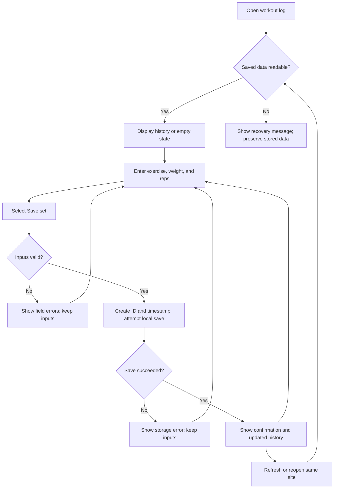

# First-Version Process Flow

Each entry is one set. Version 1 has no login, cloud synchronization, or separate session-management step. Recovery from unreadable data must not silently delete or replace it.
