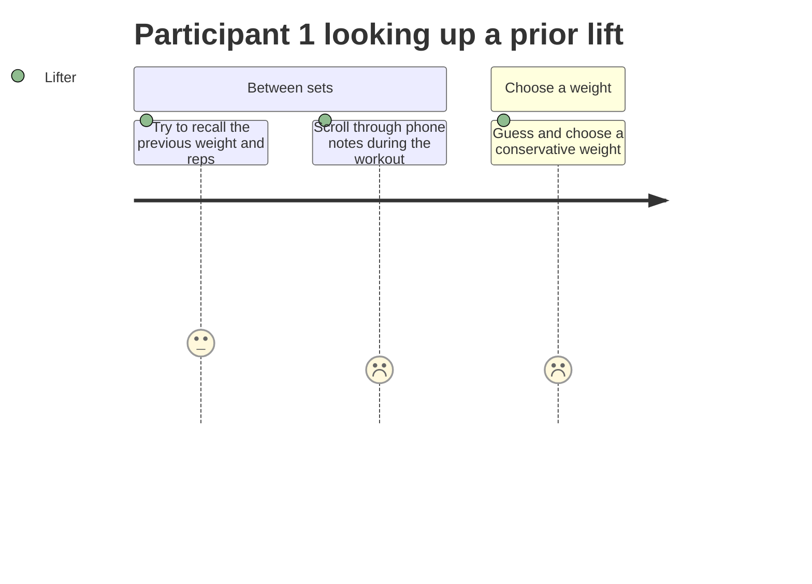

# Gym Workout Log — Requirements

Status: Interview synthesis and first-version requirements. The first version is built and deployed; see the version 1 verification report for checks completed.

## Problem statement

The interviewed lifters use notes, spreadsheets, or memory to track workouts. All three described forgetting previous weights or reps. Finding past numbers and entering new results can interrupt a workout.

Each described a recent incident. [Participant 1](interview-1.md) guessed at the weight for cable lateral raises. [Participant 2](interview-2.md) lost track of the prior top set after changing bars and described pinching and zooming in a spreadsheet between sets. [Participant 3](interview-3.md) could not recall the exact weight or reps for a dumbbell chest press. The interviews did not establish a weekly frequency or measure time lost.

## Job to be done

When I am logging an exercise at the gym, I want to quickly see what I lifted previously and record today’s weight and reps, so I can track changes without relying on memory.

## Users and stakeholders

| Role | Who | Need |
|---|---|---|
| Primary user | Individual lifter | Record sets on a phone and retrieve recent results during workouts ([P1](interview-1.md), [P2](interview-2.md), [P3](interview-3.md)). |
| Other stakeholders | To be determined | Interviews focused on the lifters' own tracking. |

The first version is for individual workout tracking. Coaching and team management are outside its scope.

## Persona

A lifter who uses a phone during workouts, wants to record weights and reps with little effort, and needs previous results easy to find. This is a synthesis of the interviews rather than an additional participant.

## Current process (as-is)

1. Begin an exercise and try to recall or retrieve a prior result ([P1](interview-1.md), [P2](interview-2.md), [P3](interview-3.md)).
2. Depending on the lifter, scroll through phone notes, navigate a training spreadsheet or rely on memory ([P1](interview-1.md), [P2](interview-2.md), [P3](interview-3.md)).
3. If the prior weight or reps are unclear, use a workaround. Participant 1 described guessing and choosing a conservative weight ([P1](interview-1.md)).

## Journey map

This map follows Participant 1's account. Mood scores are illustrative estimates based on the reported friction.

## Evidence

- [Participant 1](interview-1.md): messy notes are difficult to search; wants previous numbers beside new entry fields.
- [Participant 2](interview-2.md): spreadsheet cells are awkward on a phone; wants fast logging and accessible history.
- [Participant 3](interview-3.md): relies mainly on memory; wants minimal setup and logging in about ten seconds per exercise.

## Riskiest assumption

A simple form plus accessible previous results will be fast enough that users keep logging during actual workouts. The interviews show interest but do not demonstrate continued use.

Proposed validation: ask the three participants to log an exercise and find its previous result on their phones without help. Record time, errors, and their feedback. No usability testing has been completed yet.

## Functional requirements

| ID | The system shall | Priority | Source |
|---|---|---|---|
| FR-1 | Accept an exercise, weight in pounds and reps for one performed set. | Must | [P1](interview-1.md), [P3](interview-3.md) |
| FR-2 | Save a dated entry, confirm the save and retain the entry after refresh in the same browser. | Must | [P1](interview-1.md), [P2](interview-2.md) support keeping history. Dating, confirmation and same-browser persistence are design decisions. |
| FR-3 | Display saved results with exercise, date, weight and reps. | Must | [P1](interview-1.md), [P2](interview-2.md), [P3](interview-3.md) |
| FR-4 | Show the previous result beside the new entry fields. | Could | [P1](interview-1.md) |

## Non-functional requirements

| ID | Category | Requirement | Source |
|---|---|---|---|
| NFR-1 | Usability | Let lifters enter data and review history on a phone with minimal setup. | [P1](interview-1.md), [P2](interview-2.md), [P3](interview-3.md) |

## MVP scope

**In** — FR-1 through FR-3 and NFR-1. **Out** — FR-4 and the deferred features below. The first release uses history to retrieve previous results.

- Enter an exercise, weight in pounds, and reps.
- Save a dated entry and show a clear confirmation.
- View workout history with the exercise, weight, reps, and date.
- Keep saved entries after refreshing in the same browser.
- Use a phone-friendly layout with minimal setup.

Each saved entry represents one performed set. Users can add more entries for additional sets. History provides access to previous results; an inline previous-result display remains a future enhancement.

## Deferred features

Inline previous results, rest timers, repeat-session shortcuts, exercise swaps, progression recommendations, charts, accounts, cloud synchronization, and AI features. These requests are recorded but are not all necessary for the first version.

## Limits and implementation decisions

- Version 1 uses browser local storage. Data stays in the same browser profile and site, does not synchronize, and can be lost if browser data is cleared. Accounts and a database belong to Sprint 2.
- Interview dates and methods were not supplied.
- Exercise names are free text, trimmed before saving. Entries are displayed newest first and dated automatically; there is no separate workout-session object in version 1.
- This document records proposed requirements, not completed app behavior.
